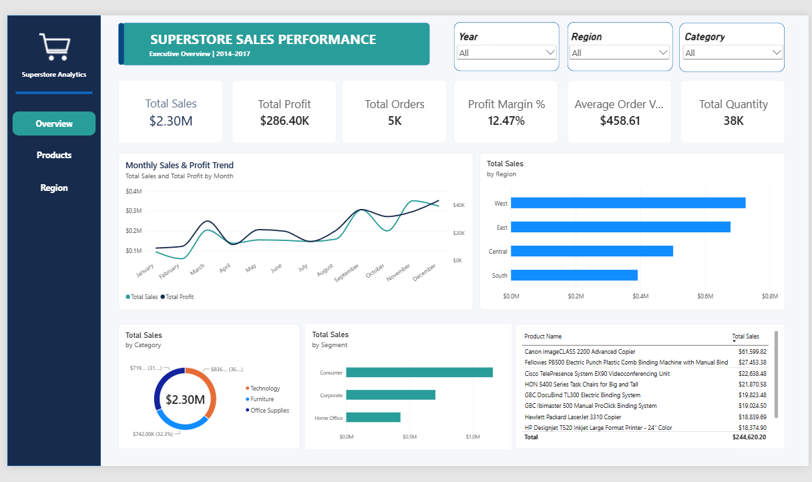

# Superstore Sales Performance Dashboard

An end-to-end Business Intelligence project built with **Microsoft Power BI** to analyse sales performance, profitability, customer segments, product categories, and regional trends using the Sample Superstore dataset.

## Project Overview

This project transforms raw retail transaction data into an interactive dashboard that helps users understand business performance and identify sales and profitability trends.

## Dashboard Preview



## Business Objectives

- Monitor overall sales, profit, order volume, and profit margin.
- Analyse monthly sales and profit trends.
- Compare performance across regions and product categories.
- Understand sales contribution by customer segment.
- Identify top-performing products.

## Key Performance Indicators (KPIs)

| KPI | Result |
|---|---:|
| Total Sales | $2,297,200.86 |
| Total Profit | $286,397.02 |
| Total Orders | 5,009 |
| Total Quantity | 37,873 |
| Profit Margin | 12.47% |
| Average Order Value | $458.61 |

## Tools & Technologies

- **Microsoft Power BI** – Dashboard development and data visualisation
- **Power Query** – Data cleaning and transformation
- **DAX** – Measures and KPI calculations
- **Star Schema** – Data modelling
- **Microsoft Excel** – Data inspection and preparation
- **GitHub** – Project documentation and version control

## Data Preparation

Data preparation was performed in Power Query, including:
- Reviewing the source dataset and column data types.
- Preparing the sales fact table and dimension tables.
- Removing unnecessary columns from dimension tables.
- Creating date attributes for time-based analysis.
- Checking key fields and table relationships.

## Data Model

The model follows a **Star Schema** structure.

**Fact table**
- FactSales

**Dimension tables**
- DimCustomer
- DimProduct
- DimGeography
- DimDate

The dimension tables connect to FactSales through one-to-many relationships.

## DAX Measures

```dax
Total Sales = SUM(FactSales[Sales])

Total Profit = SUM(FactSales[Profit])

Total Orders = DISTINCTCOUNT(FactSales[Order ID])

Total Quantity = SUM(FactSales[Quantity])

Profit Margin % = DIVIDE([Total Profit], [Total Sales], 0)

Average Order Value = DIVIDE([Total Sales], [Total Orders], 0)
```

## Key Findings

- **West** is the highest-performing region by sales, contributing approximately $725,457.82.
- **Technology** is the highest-performing product category by sales, contributing approximately $836,154.03.
- **Consumer** is the largest customer segment by sales, contributing approximately $1,161,401.34.
- The overall profit margin is **12.47%**.

## Project Structure

```text
superstore-sales-performance/
├── README.md
├── data/
├── docs/
└── screenshots/
```
