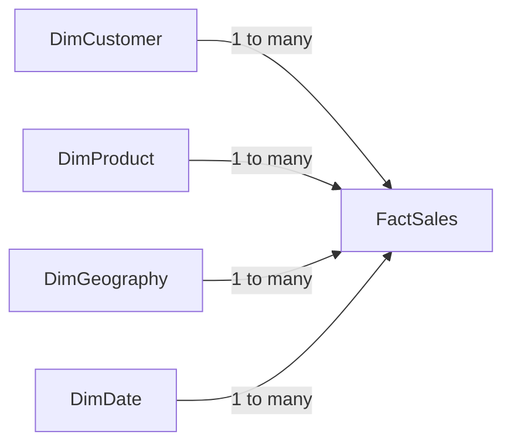

<!--
PANDUAN CEPAT (komen ini tidak muncul di GitHub)

TUKAR ANGKA/TEKS : edit teks antara tag, contohnya <li>teks anda</li> atau <b>12.47%</b>
TAMBAH POINT     : salin satu baris <li>...</li> dan tukar teksnya
TAMBAH KAD KPI   : salin satu blok <td>...</td> dalam jadual KPI
TAMBAH BADGE     : salin satu baris  dan tukar nama/warna
FORMAT BADGE     : https://img.shields.io/badge/NAMA-KODWARNA?style=flat&logo=NAMA_LOGO&logoColor=white
SPASI DALAM NAMA : %20
RAJAH DATA MODEL : blok ```mermaid di bahagian Data Model. Satu baris = satu sambungan jadual.
-->

<!-- ===================== TAJUK (di tengah) ===================== -->
<h1 align="center">Superstore Sales Performance Dashboard</h1>

<p align="center">
  An end-to-end Business Intelligence project built with <b>Microsoft Power BI</b> to analyse sales performance, profitability, customer segments, product categories, and regional trends using the Sample Superstore dataset.
</p>

<!-- Badge tools. Badge kuning guna logoColor=black supaya ikon nampak jelas -->
<p align="center">
  
  
  
  
  
</p>

<!-- Gambar dashboard -->
<p align="center">
  
</p>

<!-- ===================== OVERVIEW ===================== -->
## 📌 Project Overview

This project transforms raw retail transaction data into an interactive dashboard that helps users understand business performance and identify sales and profitability trends.

<!-- ===================== OBJECTIVES ===================== -->
## 🎯 Business Objectives

<ul>
  <li>Monitor overall sales, profit, order volume, and profit margin.</li>
  <li>Analyse monthly sales and profit trends.</li>
  <li>Compare performance across regions and product categories.</li>
  <li>Understand sales contribution by customer segment.</li>
  <li>Identify top-performing products.</li>
</ul>

<!-- ===================== KPI ===================== -->
<!-- Setiap <td> ialah satu kad. Tiga kad setiap baris. -->
## 📈 Key Performance Indicators

<table align="center">
  <tr>
    <td align="center"><b>$2,297,200.86</b><br>Total Sales</td>
    <td align="center"><b>$286,397.02</b><br>Total Profit</td>
    <td align="center"><b>12.47%</b><br>Profit Margin</td>
  </tr>
  <tr>
    <td align="center"><b>5,009</b><br>Total Orders</td>
    <td align="center"><b>37,873</b><br>Total Quantity</td>
    <td align="center"><b>$458.61</b><br>Average Order Value</td>
  </tr>
</table>

<!-- ===================== TOOLS ===================== -->
## 🛠️ Tools & Technologies

| Tool | Purpose |
|---|---|
| **Microsoft Power BI** | Dashboard development and data visualisation |
| **Power Query** | Data cleaning and transformation |
| **DAX** | Measures and KPI calculations |
| **Star Schema** | Data modelling |
| **Microsoft Excel** | Data inspection and preparation |
| **GitHub** | Project documentation and version control |

<!-- ===================== DATA PREPARATION ===================== -->
## 🔧 Data Preparation

Data preparation was performed in Power Query, including:

<ul>
  <li>Reviewing the source dataset and column data types.</li>
  <li>Preparing the sales fact table and dimension tables.</li>
  <li>Removing unnecessary columns from dimension tables.</li>
  <li>Creating date attributes for time-based analysis.</li>
  <li>Checking key fields and table relationships.</li>
</ul>

<!-- ===================== DATA MODEL ===================== -->
## 🗂️ Data Model

The model follows a **Star Schema** structure. The dimension tables connect to `FactSales` through one-to-many relationships.

<!-- Rajah ini dilukis automatik oleh GitHub. Satu baris = satu sambungan. -->


| Table type | Table name |
|---|---|
| **Fact table** | `FactSales` |
| **Dimension tables** | `DimCustomer`, `DimProduct`, `DimGeography`, `DimDate` |

<!-- ===================== DAX ===================== -->
## 🧮 DAX Measures

```dax
Total Sales = SUM(FactSales[Sales])

Total Profit = SUM(FactSales[Profit])

Total Orders = DISTINCTCOUNT(FactSales[Order ID])

Total Quantity = SUM(FactSales[Quantity])

Profit Margin % = DIVIDE([Total Profit], [Total Sales], 0)

Average Order Value = DIVIDE([Total Sales], [Total Orders], 0)
```

<!-- ===================== KEY FINDINGS ===================== -->
## 💡 Key Findings

| Category | Top performer | Sales contribution |
|---|---|---|
| **Region** | West | ~$725,457.82 |
| **Product category** | Technology | ~$836,154.03 |
| **Customer segment** | Consumer | ~$1,161,401.34 |

<ul>
  <li>The overall profit margin is <b>12.47%</b>.</li>
</ul>

<!-- ===================== PROJECT STRUCTURE ===================== -->
## 📁 Project Structure

```text
superstore-sales-performance/
├── README.md
├── data/
├── docs/
└── screenshots/
```
